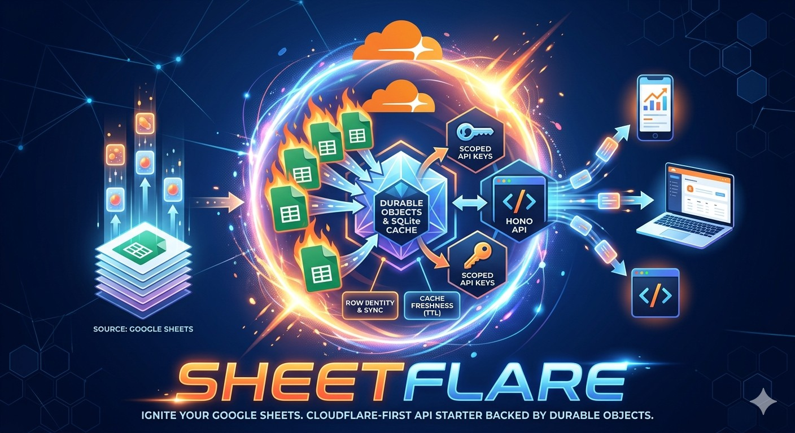

# Sheetflare



Sheetflare turns Google Sheets tabs into a REST API. It runs on Cloudflare Workers, caches rows in Durable Objects so reads don't hit Google's API on every request, and ships a lightweight admin UI for managing projects and API keys. It is suited for controlled self-hosted deployments and has not yet been validated for broad public-facing traffic.

## Documentation

| | |
| --- | --- |
| **[Quickstart](./docs/quickstart.md)** | First deployment - start here |
| [Deploy Guide](./docs/deploy.md) | CI setup, Cloudflare token scopes, manual fallbacks |
| [Operator Runbook](./docs/operator-runbook.md) | Day-2 ops: cache inspection, reindex, credentials, failure handling |
| [Google Service Accounts](./docs/google-service-accounts.md) | Credential setup, secret layout, key rotation |
| [Observability](./docs/observability.md) | Structured log events, alert plan |
| [Benchmarking](./docs/benchmarking.md) | Load testing and production evidence |

Project policies: [LICENSE](./LICENSE)

## Get Started

1. Create a sheet with a tab whose first row contains unique column names, including `_id`.
2. Ensure Node.js 22 or newer is installed, then run:

```powershell
npm install
npx wrangler login    # Cloudflare Worker deployment
gcloud auth login     # lets setup create Google credentials automatically; skip if you have a service-account JSON
npm run setup
```

3. When setup prints a service-account email, share the sheet with it as **Editor**, then return to setup.
4. Setup deploys and tests the API, then prints every credential it minted (the bootstrap admin token and the setup API keys) once, in a block headed `SAVE THESE CREDENTIALS NOW`. Copy them into your password manager before closing the terminal: setup never stores them and cannot show them again. Sign in to `/admin/` with the admin API key from that block.

`npm run setup` prompts for your Sheet URL and tab name, deploys the Worker, and bootstraps the first project and API keys. It then prints your API URL and the admin UI at `<your-worker>/admin/`.

Have a Google service-account JSON already? Skip `gcloud auth login`; setup will ask for its path. Full walkthrough: [docs/quickstart.md](./docs/quickstart.md).

## How It Works

Each Google Sheet tab you connect becomes a **table** inside a **project**. Sheetflare syncs rows from the sheet into a local SQLite cache inside a Cloudflare Durable Object. Reads and queries serve from that cache; writes go to the sheet first and then update the cache immediately. Google Drive watches trigger automatic cache refreshes when the source sheet changes.

The `setup` command manages the full first-run lifecycle: Google credential provisioning, Worker secrets, deploy, project bootstrap, and smoke validation. For reruns, use targeted flags: `--deploy`, `--bootstrap`, `--smoke`, `--verify`.

## Workspaces

| Workspace | Role |
| --- | --- |
| `apps/api` | Cloudflare Worker, Durable Object entrypoints, hosted admin assets |
| `apps/admin` | React admin UI (served by the Worker at `/admin/`, or locally by Vite) |
| `packages/contracts` | Shared request/response/RPC/error types |
| `packages/domain` | Row, pagination, and schema utilities |
| `packages/google-sheets` | Google Sheets service-account client |
| `packages/cloudflare` | Durable Object implementations |

## Commands

```powershell
npm install        # install all workspace dependencies
npm run check      # lint + typecheck + test + build
npm run setup      # guided first-time deploy and configuration
npm run dev:api    # local API Worker dev server
npm run dev:admin  # optional loopback admin UI against any deployment
npm run deploy     # deploy the API Worker
npm run smoke      # smoke test against a live deployment
npm run load       # load harness against a live deployment
npm run e2e:local  # local end-to-end: API smoke + admin browser automation
```

## Operator Scripts

These target a live deployment. Most require `SHEETFLARE_BASE_URL` and `SHEETFLARE_ADMIN_CREDENTIAL`.

**Setup reruns**

```powershell
npm run setup -- --apply-secrets  # re-apply Worker secrets; mints a new bootstrap token (shown once) and re-registers Drive watches
npm run setup -- --deploy         # redeploy the API Worker
npm run setup -- --bootstrap      # re-run project/table bootstrap; existing API keys are left alone
npm run setup -- --bootstrap --rotate-keys  # replace the setup API keys; new ones are shown once, old ones revoked
npm run setup -- --smoke          # re-run smoke validation
npm run setup -- --verify         # re-run post-deploy verification
npm run doctor                    # alias for --verify; quickest health check
```

**Keys and bootstrap**

```powershell
npm run ops:create-admin-key  # create a scoped admin API key
npm run ops:bootstrap         # bootstrap projects/tables/keys from JSON config (skips key names that are already active; rotation: see docs/operator-runbook.md)
```

**Cache and reindex**

```powershell
npm run ops:cache              # inspect cache status for one table
npm run ops:cache:health       # batch health check (exits non-zero if unhealthy)
npm run ops:reindex            # force full reindex on a table
```

**Drive watches**

```powershell
npm run ops:watch:drive               # register or renew all spreadsheet Drive watches
npm run ops:watch:drive:status        # current watch state
npm run ops:watch:drive:retry-advice  # timing guidance for re-registration
npm run ops:watch:drive:stop          # stop known watches
```

## Concepts

**Auth** - Every project is private by default. Admin routes accept the bootstrap bearer token or a scoped admin API key. Data routes accept scoped API keys unless the project is configured as `public-read`. Available scopes: `admin:projects`, `admin:keys`, `table:read`, `table:create`, `table:update`, `table:delete`. Use the bootstrap token as break-glass only - create a scoped admin key after first deploy and use that for routine work. Project-scoped keys with `admin:keys` can create keys only for their own project and only with scopes the creator already holds. A missing or invalid credential returns `401`; a valid key without the required scope returns `403` with code `FORBIDDEN`.

**Row identity** - Every table requires a stable ID column (default: `_id`). Row numbers in the sheet are cache metadata, not identity - Sheetflare re-resolves rows by ID before every write, so manually reordering rows in the sheet is safe. All managed IDs must be unique and non-blank; duplicate or missing IDs block syncs.

**Caching** - Reads (`list`, `get`, `schema`) serve from the local cache. Freshness is controlled by `cacheTtlSeconds` (an integer from 0 to 3600). Full syncs are bounded to the declared header width. Config changes that affect cache shape automatically trigger a resync on the next read or write. A write that commits while a sync is still reading Google is never lost from the cache: the sync's older snapshot is promoted, but the cache is marked stale (`staleReason: "external-change"`), so the next read resyncs instead of serving rows from before the write.

**Field rules** - Declare `readOnlyFields` to prevent API writes from touching formula-derived or operator-managed columns. Declare `fieldRules` to enforce required fields, unique values, enum constraints, normalization (trim/lowercase), and explicit type coercion (number, boolean, date, datetime) on writes. Fields with normalization rules are filtered, sorted, and uniqueness-checked by their normalized value. Date and datetime values must be real calendar values, so `2026-02-30` is rejected. Sheet reads are string-first by default; use `fieldRules.type` when a field needs typed indexed filtering.

**Queries** - Filters are AND-only. Sort is single-field with keyset pagination cursors. Indexed fields (declared in `indexedFields`) use fast cache lookups. `contains` and `startsWith` are case-sensitive, scan-heavy operators and are blocked above `TABLE_MAX_FULL_SCAN_ROWS`. `rowNumber` filters accept numeric operands only; `startsWith` and `contains` on `rowNumber` return `400`. `id` filters compare managed IDs as strings: a numeric or boolean operand is converted to its string form (`{"id":{"eq":5}}` matches the ID `"5"`), and range operators compare text order, so `{"id":{"gt":5}}` matches `"6"` but not `"10"`. A pagination cursor is valid only while the table's data is unchanged. If cached rows change between pages, the request returns `400` with `details.reason: "stale-cursor"`, and clients restart pagination without a cursor. Passing a filter or sort on a non-indexed field is rejected rather than silently doing a full scan. The interactive API reference at `/docs` documents all filter operators and query parameters.

**CORS** - The admin UI is served from the Worker's own origin (or the local loopback proxy), so no CORS setup is needed for normal admin use. If you intentionally call the Worker API from another browser origin, set `SHEETFLARE_ALLOWED_ORIGINS` to a comma-separated list of allowed origins.

**Starting envelope** - Conservative defaults before you have staging data: `TABLE_MAX_FULL_SCAN_ROWS` defaults to 10,000; keep `cacheTtlSeconds` between 15–60 seconds; keep `indexedFields` lean (hard limit: 32 including the ID column). Replace these with measured limits from [docs/benchmarking.md](./docs/benchmarking.md).

## API Reference

With the Worker running:

- `GET /docs` - interactive OpenAPI UI
- `GET /doc` - raw OpenAPI document

The docs reflect the full HTTP surface: auth requirements, path and query parameters, request/response shapes. Admin POST routes create by default; add `?upsert=true` to replace an existing config. Admin DELETE routes remove Sheetflare configuration and clear cached state - they do not delete the upstream spreadsheet or tab.

## Admin UI

Open `https://<your-worker>/admin/` from any browser and sign in with a scoped admin API key; `npm run setup` prints the exact URL after deploy. Use the bootstrap token only as break-glass. The key stays in browser memory for the session, and password managers can save it for the Worker's origin. The Worker serves only static files at `/admin/`; every action still goes through the authenticated `/v1/admin/*` API.

Set `"adminUi": "disabled"` in `sheetflare.setup.json` and redeploy to remove the hosted admin. Optional hardening with Cloudflare Access is in [docs/deploy.md](./docs/deploy.md#admin-ui).

For development, or to use a CLI-held credential, run `npm run dev:admin` and open `http://127.0.0.1:4173`. That loopback server targets `SHEETFLARE_API_BASE_URL`, then `apiUrl` in `.sheetflare.setup.local.json`, then `http://127.0.0.1:8787`, and can attach `SHEETFLARE_ADMIN_CREDENTIAL` server-side. See [Local Admin UI](./docs/deploy.md#local-admin-ui).

The admin UI covers the full control plane: create and delete projects and tables, create and revoke API keys, inspect cache status, and trigger reindex. Drafts are validated before submitting. Deleting a table clears its local cache before removing table metadata. Deleting a project clears table caches, revokes that project's API keys, and stops Drive watches for spreadsheets no remaining project uses. Delete operations are idempotent.
